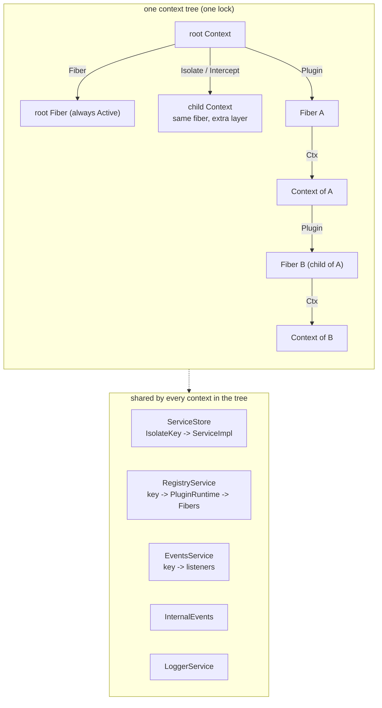
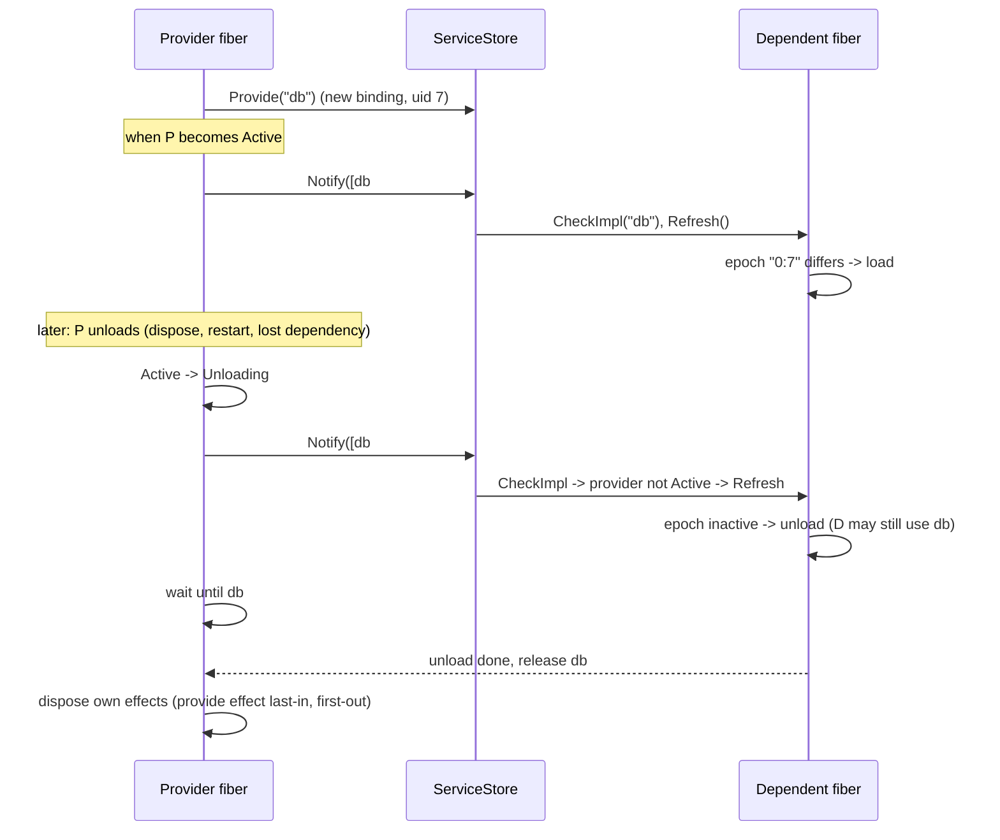
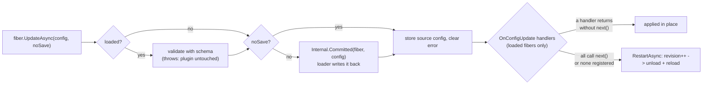
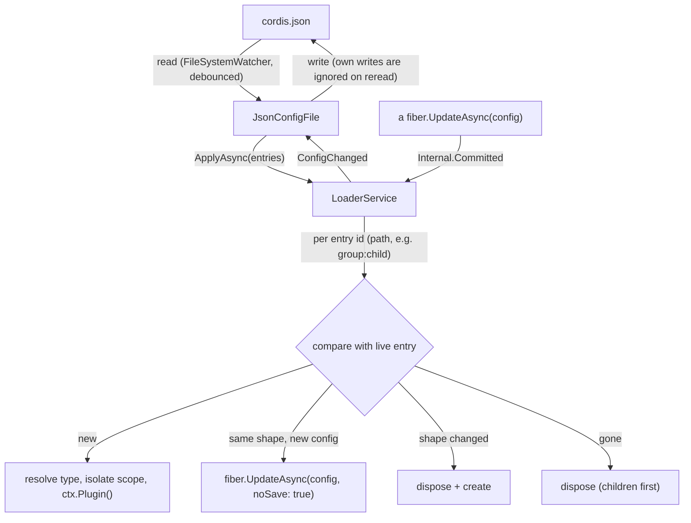

# Architecture

## Assemblies

| Project | Namespace | Contents | Depends on |
| --- | --- | --- | --- |
| `src/Cordis` | `Cordis` | contexts, fibers, effects, services, registry, events, logger, config schemas | the BCL only |
| `src/Cordis.Timer` | `Cordis.Timers` | `TimerService`: timeouts, intervals, delays, debounce, throttle, owned by the caller | `Cordis` |
| `src/Cordis.Loader` | `Cordis.Loading` | `LoaderService` (entry tree to plugin tree) and `JsonConfigFile` (file source with watch and write-back) | `Cordis` |
| `tests/Cordis.Tests` | `Cordis.Tests` | behavioural tests on a small custom runner | all three |
| `samples/Cordis.Sample` | | end-to-end demo | all three |
| `samples/Cordis.Examples` | `Cordis.Examples` | one runnable example per feature | all three |

There are no NuGet dependencies. `Directory.Build.props` targets `net10.0`; `-p:CordisTfm=net8.0`
builds with an older SDK.

## Source map (`src/Cordis`)

| File | Types | Role |
| --- | --- | --- |
| `Context.cs` | `Context` | public surface; scoping (`Isolate`, `Intercept`), plugin creation, pass-throughs to the services below |
| `Fiber.cs` | `Fiber`, `FiberState`, `ConfigUpdateHandler` | lifecycle state machine, epoch, effects, update chain |
| `Effects.cs` | `EffectHandle`, `Disposer` | one acquisition and its cleanups, including adopted child effects |
| `ServiceStore.cs` | `ServiceStore`, `ServiceImpl` | bindings per realm, resolution, change notification |
| `Registry.cs` | `RegistryService`, `PluginRuntime`, `IPlugin`, `PluginFactory` | plugin identities, replacement and forwarding, reflection-based construction |
| `Events.cs` | `EventsService`, the key types, `InternalEvents`, `AggregateError` | typed user events and framework lifecycle events |
| `Primitives.cs` | `ChainMap<T>`, `IsolateKey`, attributes, exceptions, `IAsyncInit`, `IContextScoped` | building blocks |
| `Service.cs` | `Service`, `Service<TSelf>` | base class for a plugin that provides itself |
| `Config.cs` | `IConfigSchema`, `DataAnnotationsSchema<T>`, `DelegateSchema<T>` | validation |
| `Logger.cs` | `LoggerService`, `Logger`, exporters | logging with a per-subtree level |

## Object graph

One `new Context()` creates a **tree**. Everything below the dashed line is shared by every
context in the tree; each child context differs only in its fiber and its two layered maps.

Ownership runs along the fiber tree. A fiber's effects include the anchors of its child fibers,
so disposing a fiber disposes its subtree first.

| Object | Owned by | Created by | Lifetime |
| --- | --- | --- | --- |
| `Context` | nobody (cheap view) | `new Context()`, `Isolate`, `Intercept`, fiber creation | garbage collected |
| `Fiber` | its parent fiber, through an anchor effect | `ctx.Plugin` / `Apply` / `Inject` | until disposed |
| `EffectHandle` | a fiber | `ctx.Effect*`, `Provide`, `On`, `Use`, child plugins | until the fiber unloads or the handle is disposed |
| `ServiceImpl` | the providing fiber (`Provisions`) | `ctx.Provide` | until its provide effect is disposed and its dependents have released it |
| `PluginRuntime` | the registry | first `ctx.Plugin` of a plugin identity | until its last fiber is disposed |

## Flow: creating a plugin

```mermaid
sequenceDiagram
    participant Caller
    participant Ctx as Context
    participant Reg as RegistryService
    participant F as Fiber
    participant Store as ServiceStore
    Caller->>Ctx: Plugin<T>(config)
    Ctx->>Reg: Forward(T) (follow replacements)
    Ctx->>Reg: GetOrAdd runtime
    Ctx->>F: new Fiber(parent, runtime, config, inject)
    F->>Store: CheckImpl per injected name
    F->>F: anchor effect on the parent fiber, Refresh()
    alt every dependency available
        F->>F: SetEpoch -> Loading, schedule ReloadAsync
    else something missing
        F->>F: stays Pending
    end
    Ctx-->>Caller: Fiber (awaitable)
    Note over F: ReloadAsync (after Task.Yield):<br/>commit bindings, validate config,<br/>run body, IAsyncInit, drain async effects -> Active
```

## Flow: a provider appears or disappears

The wait in the middle is what makes "dependents unload before providers" hold even when the
dependent is busy in an async cleanup, or has already left the registry while disposing.

## Flow: updating config

## Flow: replacing an implementation

`Registry.Replace(old, new)`:

1. resolves `old` through existing forwards, and records `old -> new` (unless they are the same);
2. takes or creates the runtime for `new`;
3. for every fiber of `old`: moves it to the new runtime, takes `new`'s dependencies, clears its
   error, bumps its revision, and refreshes. The fiber unloads the old code and loads the new one
   as soon as the new dependencies are available.

Later `ctx.Plugin(old)` calls are forwarded to `new`. Fibers that move reload independently, so
their order is not defined.

## Flow: the loader

"Shape" is the plugin name, `group`, `disabled`, `inject` and `isolate`; a config-only change is
applied as an update, anything else recreates the entry.

## Concurrency model

- **One lock per tree.** Every context in a tree shares one `SyncRoot`. All state transitions,
  store mutations, registry changes and listener registrations take it.
- **No await under the lock.** Transitions are started inside the lock but begin with
  `await Task.Yield()`, so their synchronous prefix ends there and plugin code never runs while
  the lock is held.
- **Independent fibers run concurrently.** Two fibers that react to the same change reload on the
  thread pool independently; only one fiber's own transitions are serialised.
- **Notifications are synchronous.** Checking dependents and deciding to load or unload happens
  inside the call that caused the change; the load or unload itself is asynchronous.

Details and the reasons behind them are in [Implementation](implementation.md).
