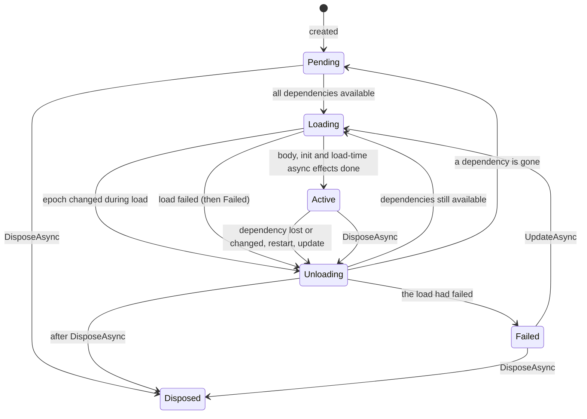

# Design

Cordis.NET is a C# port of [cordiverse/cordis](https://github.com/cordiverse/cordis). The model,
the terms and the semantics come from upstream; this document explains them as they exist in the
port, including where the port deliberately differs.

## The problem

A conventional DI container builds a fixed graph: every dependency must exist when the container
is built, a missing one is a configuration error, and a consumer keeps its dependency until the
consumer itself is disposed.

Some programs do not fit that shape: long-running hosts with plugins that come and go, services
that lose and regain a connection, configuration edited while the process runs, code swapped
without a restart. In those programs the interesting question is not "how do I construct X" but
"what should be running right now, given what is available right now".

Cordis answers that question continuously. **Service availability is a value that changes over
time**, and every plugin is a function of the services it declared: it runs while they are all
available, and unloads, releasing everything it acquired, the moment one of them goes away.

## Core concepts

| Concept | What it is |
| --- | --- |
| **Context** (`Context`) | The handle a plugin works through. Contexts form a tree; a child shares its parent's services and events, and may layer an isolation or an intercept on top. |
| **Plugin** | Code that runs against a context: a class, an `IPlugin` instance, or an inline delegate. Registered once per identity as a `PluginRuntime`. |
| **Fiber** (`Fiber`) | One live instance of a plugin: one config, one place in the tree, one lifetime. Owns the plugin's effects and drives its load and unload. |
| **Effect** (`EffectHandle`) | A resource acquisition with its cleanup. Every effect belongs to exactly one fiber and is released when that fiber unloads. |
| **Service** | A named value provided into the store by a fiber. Other fibers declare it in `Inject` and are bound to its availability. |
| **Binding** (`ServiceImpl`) | One act of providing a service. A binding is never reused: re-providing creates a new one. |
| **Epoch** | A fiber's fingerprint of what it runs against: its restart revision plus the identity of every injected binding. |
| **Realm** (`IsolateKey`) | A namespace for one service name. `ctx.Isolate(name)` starts a new realm for a subtree. |
| **Intercept** | A config layer for one name, attached to a subtree: `ctx.Intercept(name, config)`. |

## Ownership: the effect model

Every resource a plugin acquires is acquired *through its context*, so the framework knows the
owner. `ctx.Effect`, `ctx.Provide`, `ctx.On`, timers from `TimerService`, and child plugins all
register an effect on the calling fiber. When the fiber unloads, its effects are disposed in
reverse order of acquisition, one at a time.

Consequences:

- A plugin needs no teardown bookkeeping of its own. Unloading is always complete.
- A child plugin is an effect of its parent, so a subtree is torn down from the leaves up.
- Effects created by a service on behalf of a caller can be attributed to the caller (see
  [caller attribution](#caller-attribution)), so a plugin cannot leak a timer into a service that
  outlives it.

## Availability: how a fiber reacts

A fiber reacts to change by **push**, never by polling. There are four sources of change:

1. a service is provided (and its fiber is active);
2. a provide effect is disposed;
3. a provided value is swapped with `ctx.Set`;
4. a providing fiber enters or leaves the `Active` state.

Each one notifies the fibers that declared that name in the same realm. Each notified fiber reads
the current binding, recomputes its epoch, and compares it with the one it is running against:

| Old epoch | New epoch | Reaction |
| --- | --- | --- |
| same | same | nothing |
| inactive | a fingerprint | load |
| a fingerprint | inactive | unload, then `Pending` |
| a fingerprint | another fingerprint | unload, then load against the new bindings |

The notification carries no payload; the fiber reads current state. That makes reactions
idempotent (duplicate notifications cost nothing) and lets a burst of changes collapse into the
final state instead of being replayed.

Only service availability drives the lifecycle. Anything else a plugin reacts to (events, config
updates, external signals) is handled inside its body. To make a lifecycle depend on an external
condition, turn the condition into a service; see the
[gate pattern](usage.md#pattern-gate-a-plugin-on-an-external-signal).

## Lifecycle



Guarantees:

- **One transition at a time.** Changes that arrive during a transition are recorded and
  reconciled when it finishes; a fiber never runs two loads at once.
- **Latest wins.** A load superseded before it starts is skipped; one superseded while running
  is cleaned up, and its failure does not fail the newer target.
- **Dependents unload before providers.** A provider's effects are disposed only after every fiber
  that loaded against its services has finished unloading, so a dependent may still use a
  service in its own cleanup.
- **Failure is sticky.** A failed fiber ignores dependency changes and restarts; only
  `UpdateAsync` recovers it. This prevents a broken plugin from reloading in a loop.
- **Disposal settles.** A disposed fiber ends in `Disposed` and reports it through `StatusChanged`.

## Configuration

A plugin may declare a schema (`IConfigSchema`). The fiber stores the **source** config and
validates it on **every load**, so:

- a plugin never runs with an invalid config; a load with a bad config fails;
- a reload after the implementation was replaced validates against the new schema;
- while a fiber is loaded, `UpdateAsync` validates first and throws on a bad config without
  touching the running plugin.

An update has two halves. The **commit** (`Internal.Committed`) publishes the source config so it
can be persisted; `noSave: true` skips it. The **update chain** (`ctx.OnConfigUpdate`) lets the
plugin take the validated config in place; if no handler takes it, the fiber restarts.

## Isolation and intercepts

Both are layers on a context, resolved like a prototype chain: a lookup walks from the context
outwards and stops at the first layer that has the name.

- **Isolate** binds a service name to a realm for a subtree. Providers and consumers in the
  subtree meet each other and not the rest of the tree. Passing the same `IsolateKey` to two
  subtrees makes them share a realm. Lookup never crosses a realm boundary.
- **Intercept** attaches config for a name to a subtree. The chain is read innermost first; the
  config a fiber declared on its own `[Inject(name, Config = ...)]` sits below every context
  intercept. The built-in logger reads its level this way.

## Events

Events are typed by their key, and each key type fixes a dispatch mode, so a handler's signature
always matches how it is called.

| Key | Dispatch | Handler receives | Result |
| --- | --- | --- | --- |
| `EventKey<T>` | `EmitAsync`: one after another, each awaited | the args | none; the first exception stops the dispatch |
| `EventKey<T>` | `ParallelAsync`: all at once | the args | none; failures are collected into an `AggregateError` |
| `BailKey<T, R>` | `BailAsync`: one after another | the args | the first non-null result; later handlers do not run |
| `WaterfallKey<T>` | `WaterfallAsync`: nested, as middleware | the value and `next` | what the outermost handler returns |

`EmitAsync` and `WaterfallAsync` are both sequential, but they are shaped differently:

- **Emit is a loop.** The dispatcher calls each handler in turn and waits for it. Handlers do not
  see each other, cannot change what the next one receives, and cannot stop the chain (except by
  throwing). Every handler runs.
- **Waterfall is a nest.** The dispatcher calls only the first handler. That handler decides
  whether the rest run at all, by calling `next(value)` (at most once). It can change the value on
  the way in, change the result on the way out, or return without calling `next` to short-circuit.
  The terminal function runs only if every handler passed the value on.

```
emit:       h1(args) -> h2(args) -> h3(args)                     every handler, in order

waterfall:  h1(v) ── next(v') ──> h2(v') ── next(v'') ──> terminal(v'')
               <── result' ─────     <── result ───────
            h1 can wrap h2, h2 can wrap the terminal, any of them can stop early
```

Listeners are effects: unloading a plugin removes its listeners. A listener removed while a
dispatch is in progress is skipped by that dispatch.

## Caller attribution

A service method that creates effects must create them on the *caller's* fiber, or the
resource would outlive the plugin that asked for it. Upstream does this with a JavaScript
`Proxy` around every service access. The port makes it explicit: a service that implements
`IContextScoped` returns a clone bound to the calling context from `ctx.Get`. `Service` opts in
with `ScopePerCaller`; `TimerService` does, so `ctx.Get<TimerService>().Interval(...)` belongs to
`ctx`'s fiber.

## Deliberate differences from upstream

- **Strict injection.** A plugin reaches only the services it provides itself and the ones it
  declared. Upstream also lets a child fiber use its parent's injections and lets any plugin read
  services provided on the root context. In C#, the declaration is the one place a dependency is
  visible, so it stays mandatory.
- **Sequential teardown.** A fiber's effects are disposed one at a time in reverse order;
  upstream starts them concurrently.
- **Explicit resolution** instead of proxies, and **opt-in** per-caller cloning; see
  [Implementation](implementation.md).
- **Not ported:** hot module reload, YAML config and `!!js` expressions, mixins and accessors,
  stack-trace stitching. `Registry.Replace`, the primitive hot reload is built on, is ported.
